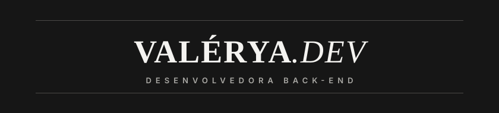

  

 

💻 Desenvolvedora back-end &nbsp;·&nbsp; 🎓 Estudante de Análise e Desenvolvimento de Sistemas &nbsp;·&nbsp; 🚀 Em busca da primeira oportunidade em TI

 

<h2 align="center">STACK</h2>

  
  
  
  
  
  
  
  

 

<h2 align="center">CONTATO</h2>

  
  
  

 

  <i>✨ Sempre aprendendo, praticando e evoluindo na tecnologia ✨</i>

